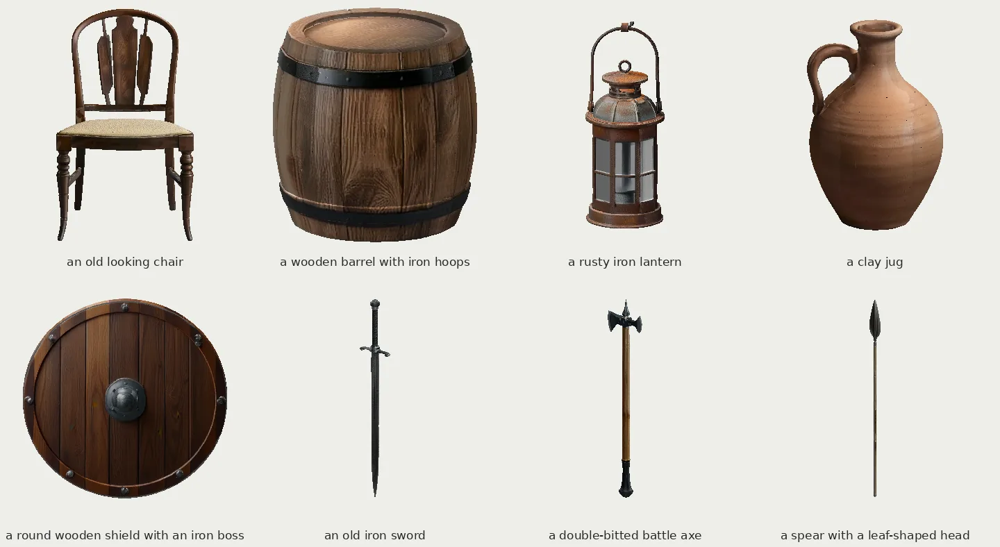
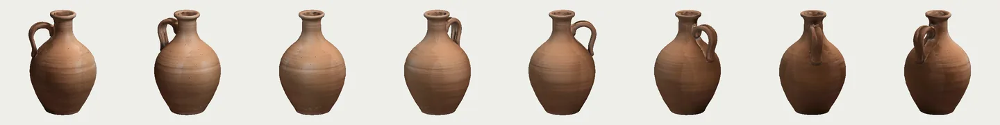
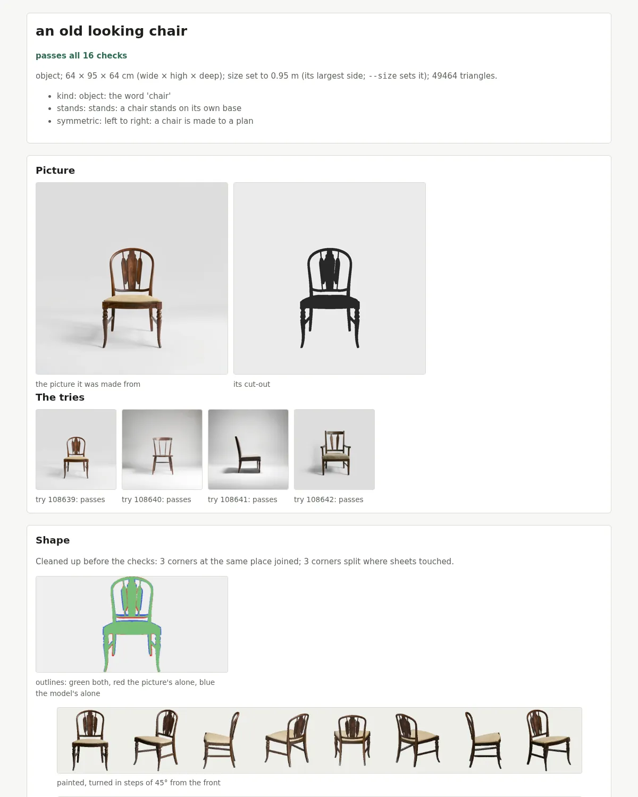

# model-maker

Make a 3-D object from a written description. A picture model paints it, a shape model builds it, a
view model paints it from six sides to fit its shape, and our own tools check it, bake its texture
and write a standard `.glb` file you can open in any 3-D tool.

```
git clone https://github.com/cicadapark/model-maker && cd model-maker
./setup.sh --check-only
./setup.sh --hf-token-file FILE
./model-maker make "an old looking chair"
./model-maker make "an old iron sword" --size 0.9
```

The first release makes **3-D objects**: furniture, containers, tools, decor, and things held in the hand such as
swords, axes, spears and shields. Characters come in the second release.

Every object is checked, and each check is measured: its outline against its picture, the mesh
whole (no holes, no loose pieces), standing on its base, mirror-symmetric where the words imply it,
the paint covering it, and what the paint touch-up filled in matching the paint round it. For a thing held in the hand,
its blade or shaft is checked straight, its grip found and its length set, and its `.glb` marks the grip and the tip
so a game can put it in a hand. Each object
comes with a report of every check and a sidecar naming every model used and its licence. See
`docs/objects.md`.

## What it makes



Eight objects made during this release's development, each from the line of text under it, each passing every
check. Every one is a `.glb` you can open in any 3-D tool, turned all the way round:



And every one comes with a report of its checks: the picture it was made from, its cut-out, the tries, the outline
against the picture, the paint, and each check's value against its limit.



## What to expect

This is an early release: the object path has been through a handful of trials on two cards (`docs/objects.md`,
`docs/trials/`).

**Pass rate: 4 of 10.** Ten prompts kept aside during development (`tools/trial/unseen-final.txt`) were made once,
at the release's code, on a 16 GB card (an RTX 3080 laptop card), about 7.5 minutes an object (the median). Four
passed every check. "Passes every check" is not "is right": each object looked at by eye says more.

| Prompt | Checks | By eye |
|---|---|---|
| a copper cooking pot with a lid | pass | fine |
| a wooden mallet | pass | fine |
| an iron anvil | pass | nonsense lettering painted on its side |
| a short curved dagger | pass | straight, though "curved" was asked |
| a wooden rocking horse | fail (paint fill) | looks right |
| a pair of leather boots | fail (paint fill) | one boot for "a pair" |
| a stone well with a wooden roof | fail (symmetry) | a smooth grey inner wall |
| a tall wooden bookshelf, empty | fail | its back and sides are bare |
| a wooden wheelbarrow | fail (outline, holes) | |
| a woven wicker basket | fail | a flat tray on its rim, not a basket |

Ten prompts are a small sample: the true rate could plausibly be anywhere from about 1 in 8 to 3 in 4. These ten
were made once for this number and are now part of the development set.

| | |
|---|---|
| System | Linux on x86_64 |
| Graphics card | NVIDIA, 12 GB or more (tried on 12 GB and 16 GB), a driver with CUDA 12 or newer |
| Computer's memory | 24 GB or more (16 GB to try) |
| Disk | about 60 GB used (models 54 GB, environment 6 GB); keep 75 GB free |
| Setup | about 20 to 35 minutes (57 GB downloaded; clean PCs took 19 to 33 minutes) |
| One object | about 7.5 minutes on a 16 GB card; 9 to 13 minutes on a 12 GB card (`docs/setup.md`, "The chair and the sword on 12 GB") |
| Also needed | git, curl, tar, a C and C++ compiler; `setup.sh` brings its own Python and, if needed, its own Rust |

**Not yet:**

* bows (a bow prompt is answered that they come later; nothing is made);
* characters: people, animals and creatures (the second release; a statue of one is an object);
* Windows and macOS; WSL2 on Windows should work the same but has not been tried;
* making an object without an NVIDIA card: there is no CPU path for the picture, shape and paint models (the checks,
  the bake and the report do run on the CPU: `./model-maker inspect`, `./model-maker finish`).

**Known limits:**

* one object, in one piece: "a pair of ..." or "two ..." makes one;
* qualities the prompt names, such as "curved", are not checked;
* lettering painted on an object is not caught;
* the paint-fill check can fail an object whose inside rightly has another colour (a lining, shelf boards).

## Setting up

```
./setup.sh --check-only
./setup.sh --hf-token-file FILE
```

`setup.sh` brings everything into this folder: its own Python, the pinned packages, Rust if there is none, the view
painter's code and the models, each after its licence is shown and accepted, every file checked against its sha256.
One model, [FLUX.1 [schnell]](https://huggingface.co/black-forest-labs/FLUX.1-schnell), is gated: its hub page asks a
signed-in Hugging Face account to accept its terms, which shares the account's user name and e-mail address with
Black Forest Labs, and setup then needs that account's access token (a file holding the token alone, on one line).

Setup asks seven licence questions, one for each model, each just before that model downloads, so they come over about
20 minutes; to answer them all at once, read the licences first (`registry/models.toml`, `NOTICE`) and run
`./setup.sh --yes`. It uses about 60 GB (models 54 GB, environment 6 GB); keep 75 GB free. The self-test at its end
takes about 2 to 11 minutes. `--check-only` checks the PC, not the models (`.venv/bin/python -I
setup/fetch_models.py --verify` checks those once downloaded), and it does not see what else is using the card: **on a
12 GB card, stop anything else that uses the card first** (the release check's peak on a 12 GB card was 11.85 GB). See
`docs/setup.md`, also for the warnings a make prints that you can ignore.

## What you get

For each object, in its own folder, `made/<name>-<id>/` (`--out DIR` chooses another folder): its `.glb` (open it in
any 3-D tool or game engine), its sidecar (`<name>.provenance.json`: the prompt, every model used with its version and
licence, the seeds, every check) and its report (`report/report.html`: every check, measured, with the pictures it was
judged by).

## What is here

| Folder | What it holds |
|---|---|
| `model-maker` | the command: `make`, `batch`, `finish`, `inspect`, `picture-check`, `words`, `bug-report`, `reproduce` |
| `python/` | the pipeline: pictures, cut-out, shape, paint, the checks, the bake, the `.glb`, the report (`python/tests/` its tests) |
| `crates/` | the Rust crate `model-maker-simplify` (a shape to its triangle budget) |
| `registry/` | the AI models the pipeline uses, their licences and the sha256 of their files |
| `setup.sh`, `setup/` | the one command that sets a PC up (`docs/setup.md`) |
| `docs/` | how the pipeline works |
| `tools/` | the repository's own checks, and `tools/trial/` (the release's trial prompts and how to run them) |

## How to report a problem

Open an issue on GitHub with the **Bug report** form, and attach the bug report file for the job:

```
./model-maker bug-report made/chair-ec4d6029
./model-maker bug-report made/chair-ec4d6029 --with-model    # the .glb too
```

It writes one file (`bug-report-<name>-<id>.zip`; give `--out FILE.tar.gz` for a .tar.gz) and prints its size and
what it left out. It holds the job's record and sidecar, its report and pictures, the picture it was made from and
its cut-out, the job's lines from the ledger, and the versions it was made with: the code, the AI models, Python,
torch, the graphics card and its driver. The prompt is sent whole, as the remake needs it: leave out of a prompt
anything you would not post. It leaves out the large in-between files, your environment and any token, and it
replaces your home folder, your user name, your machine's name and other folder paths in every text it copies.
`README.txt` inside says what it holds. Drag the file into the form's box (GitHub takes files up to 25 MB). For a
question, use the **Question** form; for a security problem, see `SECURITY.md`.

We claim no rights in what you make; the models' terms apply (`NOTICE`). As the code that made an object is on your
machine too, we cannot take the object or its report as proof of anything: we can check a claim only by remaking it.
So a maintainer makes the same prompt with the same seeds, settings and version on a card of their own
(`./model-maker reproduce FILE --out DIR`) and compares the picture, every check's value and the verdict with yours.

## Contact

developer@cicadapark.com. Security problems: see `SECURITY.md`.

## Licence

Apache-2.0 (see `LICENSE`). Third-party code and the AI models used are listed in `NOTICE`. What
model-maker makes is made by AI systems from text prompts; each sidecar says which ones. One of them, Stable Diffusion
XL, comes under the CreativeML Open RAIL++-M licence: the use restrictions of its Attachment A apply to everything
made with it, and so to every object model-maker makes (each sidecar and report says so).

The code was written with AI (Claude); the commits name each model that helped.
