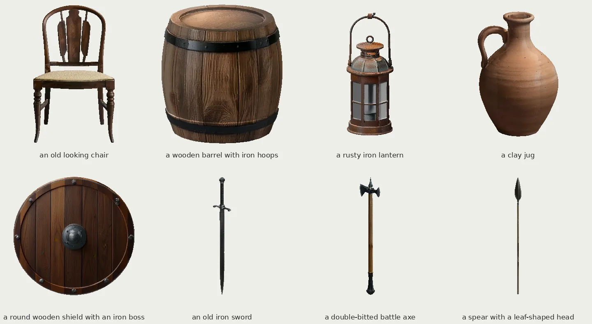

# model-maker

Make a 3-D object from a written description. A picture model paints it, a shape model builds it, a
view model paints it from six sides to fit its shape, and our own tools check it (an optional question judge asks
whether it is the thing named), bake its texture and write a standard `.glb` file you can open in any 3-D tool. It
makes furniture, containers, tools, decor, and things held in the hand such as swords, axes, spears and shields; every
object comes with a report of every check and a sidecar naming every model used and its licence.

See them in 3-D, turned round in your browser: **[Model Maker Studio](https://cicadapark.com/model-maker-studio/)** (cicadapark.com).



**On 50 new sealed prompts, 16 of 50 pass every check and are right** on a 12 GB card, 14 on a 16 GB card (0.2.1: 15
and 15); **wrong objects let through fell from 16 and 14 to 9** on each, since a question judge now asks of each
finished object "Is it the thing named?" ([every number, and the known limits](docs/results.md)).

## Start

```
git clone https://github.com/cicadapark/model-maker && cd model-maker
./setup.sh --check-only
./setup.sh --hf-token-file FILE
./model-maker make "an old looking chair"
./model-maker make "an old iron sword" --size 0.9
```

One model, FLUX.1 [schnell], is gated: setup needs a Hugging Face access token in a file
([`docs/setup.md`](docs/setup.md#a-gated-model)).

## What's needed

| | |
|---|---|
| System | Linux on x86_64 |
| Graphics card | NVIDIA, 12 GB or more, a driver with CUDA 12 or newer |
| Computer's memory | 24 GB or more (16 GB to try) |
| Disk | keep 75 GB free |
| One object | about 7.5 to 10 minutes on a 16 GB card |

The rest, with the setup's times and the recommended tesseract: [`docs/setup.md`](docs/setup.md#what-a-pc-needs).

## More

* [How it works](docs/how-it-works.md): the whole process in one diagram.
* [The documentation](docs/README.md): what you get, results and limits, setup, how it works.
* [How to report a problem](docs/problems.md).
* [Licences and content credentials](docs/licences.md): Apache-2.0 ([`LICENSE`](LICENSE)); the models' terms
  ([`NOTICE`](NOTICE)) apply to what you make. The code was written with AI (Claude); the commits name each model that
  helped.
