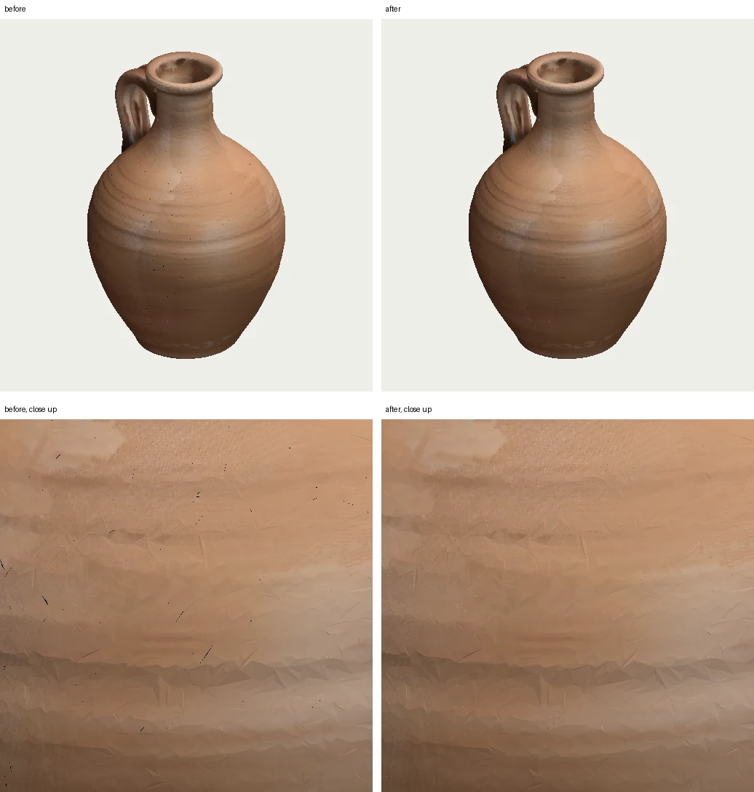
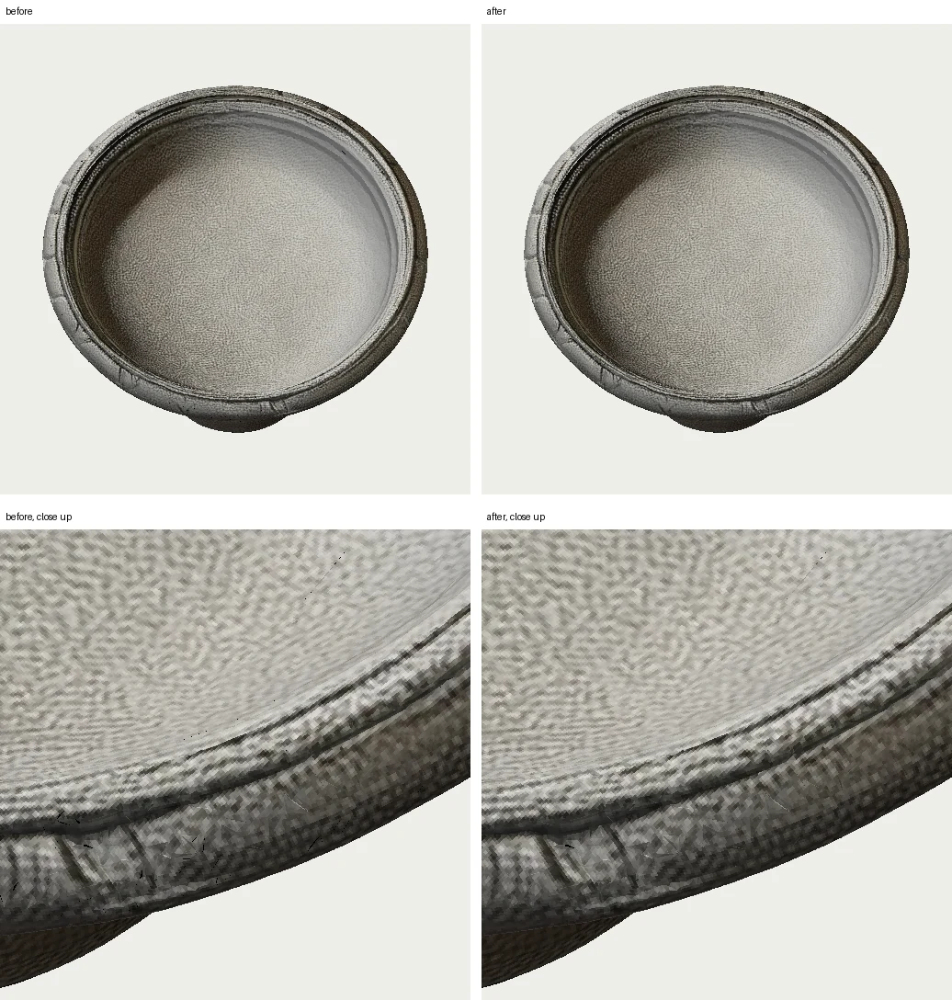

# Thin dark strokes: the bake colours every triangle

From model-maker's development: what was measured, what was fixed and what did not work, dated as it was
written. The reference is [`docs/objects.md`](../objects.md); the other topics are listed in
[`README.md`](README.md).

## Thin dark strokes: the bake colours every triangle (0.3.2)

Made objects showed short dark strokes and specks on their paint: on a clay jug's plain clay, on a stone birdbath's
rim. The bake lays the surface out flat in small pieces on one texture, and a texel takes the colour of the triangle
that holds its centre. A triangle thinner than a texel may hold no texel's centre, so no texel was given its colour,
and it showed the texture's black background as a thin dark line. Such slivers, in pieces of one to three triangles,
are common in the shape model's meshes.

Since 0.3.2 a triangle that holds no texel's centre is walked along its edges in half-texel steps and colours the
texels it touches that no triangle holds, with its own colour where it touches them (the colour cloud's, or the
corners' colours where the cloud does not reach); a texel two such triangles touch goes to the larger. After the
margins round each piece are filled, every texel still empty takes the nearest coloured texel's colour, however far,
so no black is left between the pieces for a smaller copy or a mip level to mix in. Nothing else changes: the layout,
the triangles, every texel a triangle holds and every measure the report gives (the paint's coverage, the overlap,
the texels a metre) are the same as before, which the tests check on a chair with slivers.

**Models made before.** `./model-maker finish DIR` bakes a made object again with the fix from its stored paint. For a
`.glb` alone, `./model-maker repair-texture MODEL.glb --out NEW.glb` mends its texture on the CPU: each sliver's
texels take its neighbours' colour across its edges (the colour cloud is not in the `.glb`), the rest of the file is
kept as it is, and the new texture is signed like any other.

**Measured** on 128 stored models (105 jobs baked again from their own files with the old and the new bake, and 23
models mended from their `.glb`), with the bars written and the measuring scripts sealed before any texture of the
fixed bake existed:

| Bar | Passes when | Measured | Result |
|---|---|---|---|
| Strokes gone | visible dark strokes down at least 95 %; no triangle reads an uncoloured texel; none without a texel of its own | dark strokes 29 416 to 1 141 (down 96.1 %); the sealed script also counted 1 389 triangles reading exact black and 15 with no own texel at its four read points | fail as written |
| No model left | models with 100 or more strokes: at most 3 | 103 to 0 | pass |
| No foreign colour | pale slivers not up | 2 048 to 2 467 (up 20 %) | fail as written |
| Nothing else changed | same layout, every texel the old bake coloured unchanged, same report measures | layout and report measures equal on all 105; the sealed script saw 275 held texels change; 0 on the bake's own layout | fail by the sealed script |
| Unseen places | 5 places with strokes, held back, clean | 60, 44, 53, 32 and 31 strokes to 0 | pass |
| Blind judges | "after" with fewer marks on at least 9 of 10 models with strokes | two judges alone: "after" on 10 of 10, "before" on none | pass |
| Smaller copy | strokes on 5 copies made smaller for a web viewer (their texture shrunk) down at least 95 % | 280 to 10 (down 96.4 %) | pass |
| Cost | bake time up at most 10 %; tests pass | median up 5.0 %; the tests pass | pass |

The three bars that failed stay failed as they were written; what they found:

* *Strokes gone.* The exact black that triangles read afterwards is black paint on dark models, not an empty texel:
  the bake's own record of coloured texels, kept as each bake ended, marks 0 texels uncoloured and 0 triangles reading
  one, on all 128. Of the 15 triangles without a texel of their own at the four points the script reads, 13 have
  2 to 10 texels elsewhere; 2, on one model, have none: every texel they touch belongs to a larger triangle, so they
  read their neighbour's colour, not black.
* *No foreign colour.* Of the 515 slivers newly pale, 434 read as a dark stroke or black before: the black hid an older
  fault. Truly new: 81, against 96 no longer pale. A thin triangle facing another way than the surface round it can
  take its colour from another painted view, lighter than the paint round it. No blind judge named a new mark on any
  "after" side.
* *Nothing else changed.* The sealed script rebuilt which texels a triangle holds from the file's rounded 32-bit
  texture places; the bake uses unrounded 64-bit ones, so a texel centre on a triangle's edge fell in under one and
  out under the other. Rebuilt the way the bake builds it, no held texel changed on any of the 105.

All 105 jobs baked again and all 23 models mended again with the released code give the same textures, bit for bit.

Known limits: thin pale lines remain, about 19 a model, as before the fix (very thin triangles reading a lighter
colour than the paint round them), and 2 triangles in 128 models have no texel of their own; joining the tiniest
pieces to their neighbours, the next step, is meant for both. The birdbath keeps one or two short dark marks on its
rim, hard to tell from the stone's own dark grain.
