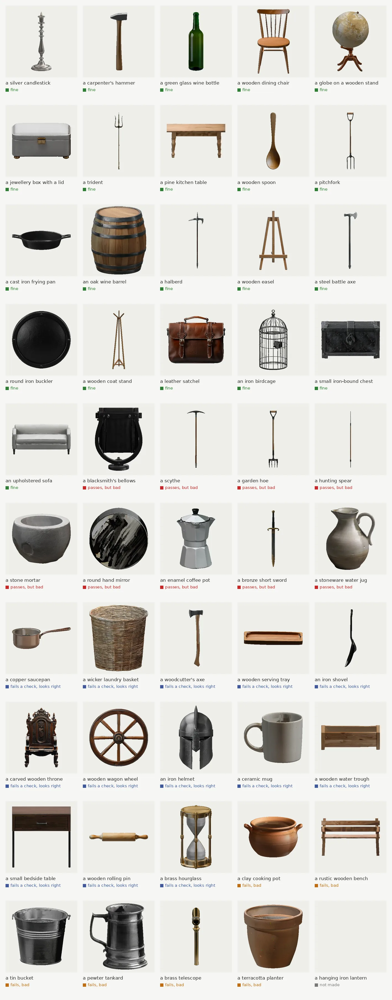
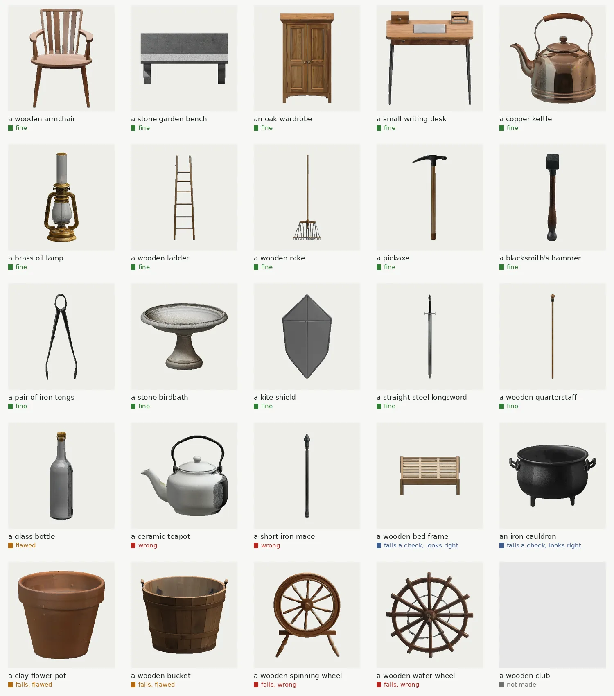

# Results, limits and what is not here yet

## 0.2.1 against 0.2.0

Fifty new prompts were written and sealed before this work began (`tools/trial/unseen-0.2.1.txt`); nothing was tuned
on them. Each was made once with 0.2.0 and once with 0.2.1, the same seeds, on a 12 GB RTX 3060 and on a 16 GB RTX 3080
laptop card. Every object was judged from renders all the way round **and from below**, by one judge (an AI model), blind: which version made which object, and the checks' verdicts, were hidden until all were judged. The
0.2.0 column ran at 0.2.0's own code (2c3ea6e).

| Of 50 | 0.2.0, RTX 3060 | 0.2.1, RTX 3060 | 0.2.0, RTX 3080 | 0.2.1, RTX 3080 |
|---|---|---|---|---|
| pass every check and right | 18 | 22 | 20 | 21 |
| pass every check but wrong | 13 | 11 | 10 | 9 |
| right but refused by a check | 11 | 10 | 11 | 13 |
| wrong and refused | 6 | 5 | 8 | 6 |
| not made | 2 | 2 | 1 | 1 |

**0.2.1 is a little better, not much.** On the 12 GB card four prompts gained (a hammer now stands upright, a mug and
a jug were repainted, a trough's fill passes); on the 16 GB card the hammer gained and a mug and a saucepan were
painted right but are now refused by a check. None got worse on either card; the rest came out the same, as the same
seeds paint the same pictures. Fifty prompts cannot tell a gain of a few from chance with confidence. We aimed at 35
and reached 21 to 22; that is why this is 0.2.1 and not 0.3.0.

One object in five (9 to 11 of 50) passes every check and is wrong: 6 to 8 times the picture model drew another thing (a
digging fork for a hoe, a pick on a pole for a scythe), and no check asks "is this the thing named?". Ten to thirteen
right objects are refused. Both are the next version's work.

These numbers are stricter than the 25-prompt table below: undersides were not judged there, so 22 of 50 and 15 of 25
are not the same measure. The whole run took 6.7 hours on the 16 GB card and 7.9 hours on the 12 GB card: 8 to 9.5
minutes an object. See the objects of earlier versions in 3-D in your browser:
**[Model Maker Studio](https://cicadapark.com/model-maker-studio/)** (cicadapark.com).

## 0.2.0's 25

This was the first measured release: the object path had been through a handful of trials on two cards (`objects.md`,
`trials/`).

**Pass rate: 15 of 25 right; 18 of 25 pass every check.** Twenty-five prompts were written before this version
was frozen and kept sealed: nothing was tuned on them (`tools/trial/unseen-0.2.0.txt`). Each was made once, at the
frozen code, on each of two cards: a 16 GB RTX 3080 laptop card and a 12 GB RTX 3060. On the 3080, 18 passed every
check (19 on the 3060). Every object was then looked at by eye, turned all the way round: on each card 15 of 25 pass
every check and are right. Both cards paint the same pictures from the same seeds, so their objects are near alike.
The whole run took 4.0 hours on the 3080 and 3.5 hours on the 3060: 8 to 10 minutes an object. See them in 3-D,
turned round in your browser: **[Model Maker Studio](https://cicadapark.com/model-maker-studio/)** (cicadapark.com).

| Prompt | Checks (3080) | By eye |
|---|---|---|
| a wooden armchair | pass | fine |
| a stone garden bench | pass | fine |
| an oak wardrobe | pass | fine |
| a small writing desk | pass | fine |
| a copper kettle | pass | fine |
| a brass oil lamp | pass | fine; its glass chimney painted opaque |
| a wooden ladder | pass | fine |
| a wooden rake | pass | fine |
| a pickaxe | pass | fine |
| a blacksmith's hammer | pass | fine |
| a pair of iron tongs | pass | fine: one object, as it should be |
| a stone birdbath | pass | fine |
| a kite shield | pass | fine |
| a straight steel longsword | pass | fine |
| a wooden quarterstaff | pass | fine |
| a glass bottle | pass | the glass painted dark on one side |
| a ceramic teapot | pass | wrong: large black patches painted on one side |
| a short iron mace | pass | wrong: a long thin rod with a small knob |
| a wooden bed frame | fail (outline, holes) | looks right |
| an iron cauldron | fail (paint fill) | looks right |
| a clay flower pot | fail (paint) | grey smears inside |
| a wooden bucket | fail (paint fill) | a tub with side handles; dark smears inside |
| a wooden spinning wheel | fail (paint fill) | wrong: a wheel on a stand |
| a wooden water wheel | fail (paint) | wrong: a wheel with no paddles |
| a wooden club | not made | no picture try showed a club |

Twenty-five prompts are still a small sample: the true rate of right objects could plausibly be anywhere from about
4 in 10 to 3 in 4. These 25 are now part of the development set. The first version's ten (`unseen-final.txt`) gave
4 of 10 passing every check, 2 of them right by eye.

### The first version's ten

**Pass rate: 4 of 10.** Ten prompts kept aside during development (`tools/trial/unseen-final.txt`) were made once,
at the release's code, on a 16 GB card (an RTX 3080 laptop card), about 7.5 minutes an object (the median). Four
passed every check. "Passes every check" is not "is right": each object looked at by eye says more.

| Prompt | Checks | By eye |
|---|---|---|
| a copper cooking pot with a lid | pass | fine |
| a wooden mallet | pass | fine |
| an iron anvil | pass | nonsense lettering painted on its side |
| a short curved dagger | pass | straight, though "curved" was asked |
| a wooden rocking horse | fail (paint fill) | looks right |
| a pair of leather boots | fail (paint fill) | one boot for "a pair" |
| a stone well with a wooden roof | fail (symmetry) | a smooth grey inner wall |
| a tall wooden bookshelf, empty | fail | its back and sides are bare |
| a wooden wheelbarrow | fail (outline, holes) | |
| a woven wicker basket | fail | a flat tray on its rim, not a basket |

Ten prompts are a small sample: the true rate could plausibly be anywhere from about 1 in 8 to 3 in 4. These ten
were made once for this number and are now part of the development set.

## Not yet

* bows (a bow prompt is answered that they come later; nothing is made);
* animals (a later release);
* characters, meaning people and fantasy creatures (after the animals); a statue of either is an object, and a prompt
  that names both ("a knight on a horse") is answered as a character;
* Windows and macOS; WSL2 on Windows should work the same but has not been tried;
* making an object without an NVIDIA card: there is no CPU path for the picture, shape and paint models (the checks,
  the bake and the report do run on the CPU: `./model-maker inspect`, `./model-maker finish`).

## Known limits

* one object, in one piece: "a pair of ..." or "two ..." is answered before any painting, asking for one thing
  ("a pair of scissors" and "a pair of tongs" are one object, and made);
* of the qualities a prompt names, "curved" and "round" are judged; others ("tall", "broken", "rusty") are not;
* lettering painted on an object is caught when it is written straight across a flat face; lettering round a rim (a
  coin, a medal) and very small marks still get through;
* a side painted out of family with the other views (the teapot's black patches) is painted again; two neighbouring
  views wrong together, and polished metal, are not caught;
* a near relative can pass for the thing asked for (a rod with a knob for a mace);
* the paint-fill check can fail an object for a small smear the eye does not notice (on a handle's foot, on the inner
  wall of a dark iron pot); a lining or shelf boards of another colour pass it.
