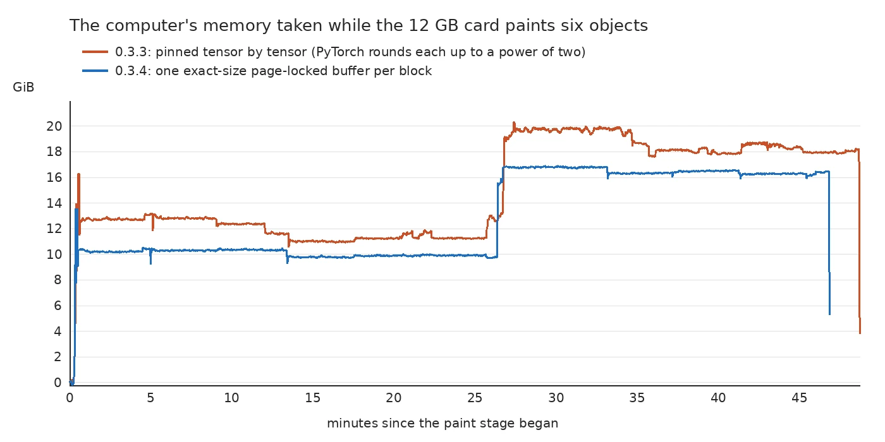
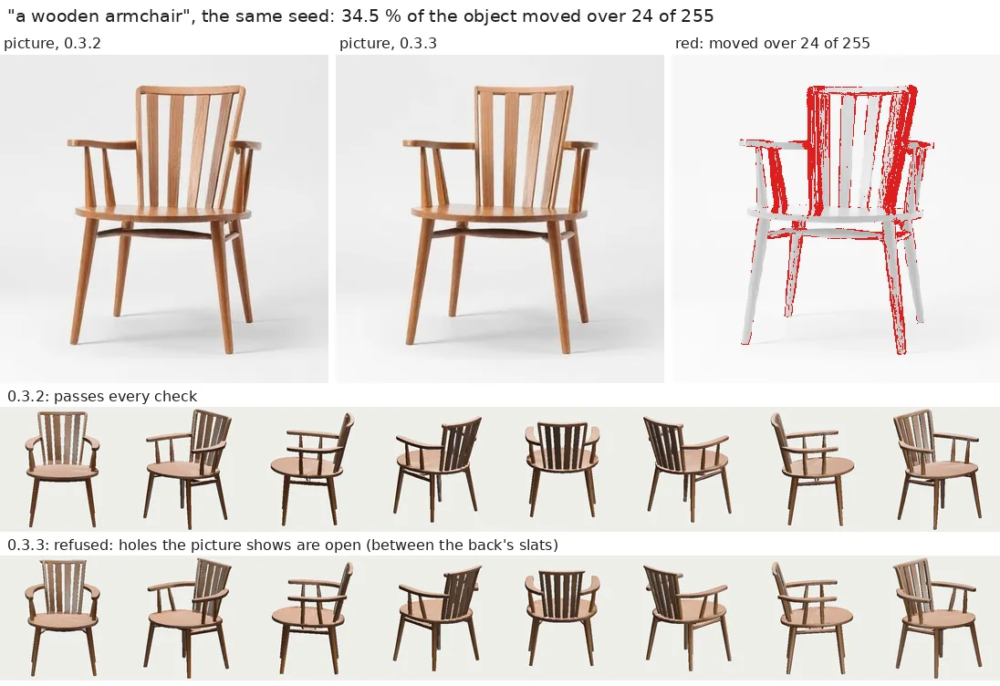
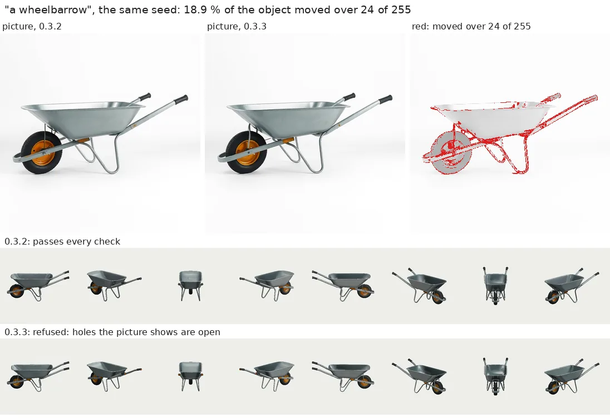
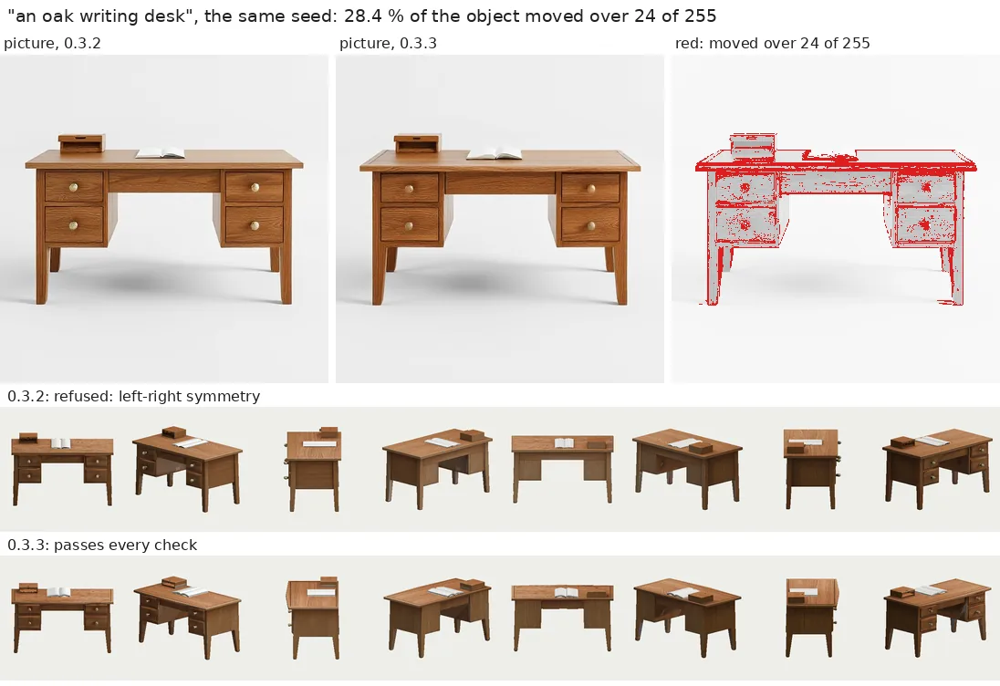
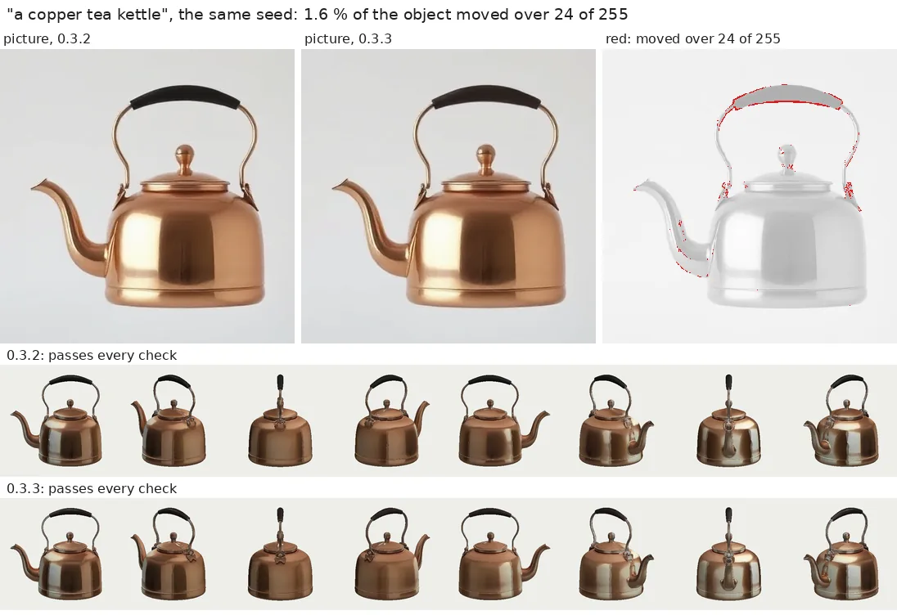
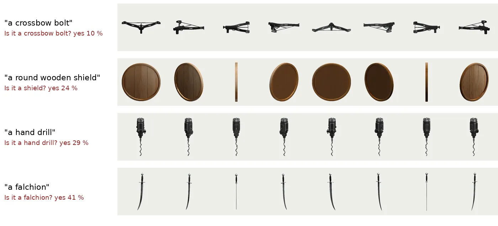
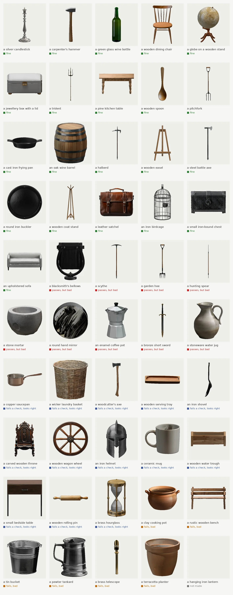

# Results, limits and what is not here yet

## 0.3.4: the 12 GB card's painter holds less memory, the same objects

On a card under 15 GB the view painter's UNet blocks wait in pinned memory of the computer and come onto the card one
at a time ([`setup.md`, "On a 12 GB card"](setup.md#on-a-12-gb-card)). PyTorch 2.10, which model-maker runs since
0.3.3, rounds every pinned tensor up to a power of two, so the 6.3 GiB of blocks held 8.2 GiB (computed from the
weights' sizes). Each block's tensors now share one buffer of exactly their size, page-locked once (`cudaHostRegister`)
and given back when the painter is closed; where the CUDA runtime refuses, that block is pinned tensor by tensor as
before. The weights are the same bytes, so the pictures and the objects are the same. The new path is not taken on
16 GB cards (by code and test: their painter keeps the UNet whole, and closing it calls nothing of the CUDA runtime).

Measured on the 12 GB card (RTX 3060) on 27 Nov 2026: the paint stage of six objects, first with 0.3.3's painter and
then with the new one, each in its own process, on copies of the same finished batch with its paint removed, nothing
else started beside them. The bars were written down before the run.

| Bar | 0.3.3 | New | Result |
|---|---|---|---|
| the blocks' output the same bit for bit, whole and offloaded (the blocks' test, a small model, on the card) | | passes | pass |
| the computer's free memory just after the painter is built: at least 1.7 GiB more | 26.54 GiB | 30.05 GiB (+3.52) | pass |
| the fall of free memory while the painter is built: at least 1.7 GiB less | 16.25 GiB | 13.59 GiB (−2.66) | pass |
| the card's memory at its peak: at most 50 MiB more | 10,069 MiB | 10,065 MiB | pass |
| paint time of the six: within +5 % | 2,878 s | 2,775 s (−3.6 %) | pass |

The second row also carries where each run began: the new run started with 0.85 GiB more free memory, so the third
row, each run against its own start, is what this change is credited with.

The painted files of the six are identical: 58 of 58 (the views compared by pixels,
as each run signs its own pictures; the textures by bytes). Then
6 of the 12 GB card's reference objects were made again from start to finish with this version and compared by
content with 0.3.3's stored reference set: identical, 286 files (gate tree = b15ff6c with the stamp of the
stored run, b3062be: the version stamp is written into every record, so it is set to the stored run's; nothing else
differs from the commit).

Not changed: the advice of 32 GB of memory with a 12 GB card stays, as it was not measured again with this change.
Whether the change explains the rise from 23.2 GB to 25.5 GB at the paint stage's peak with 0.3.3 is not known.

## 0.3.3 against 0.3.2: new libraries, another draw

0.3.3 is a security update and nothing else: the Python libraries the models run on are raised past GitHub's
dependency alerts. No check, setting, model or step of the pipeline changed. Measured in full on the 16 GB card only
(the 50 prompts of the third list); the 12 GB card was checked on six objects and on its 25 fixed reference objects.

**What changed.** PyTorch 2.5.1 (CUDA 12.4 build) to 2.10.0 (CUDA 12.8, PyPI's last CUDA 12 build), torchvision
0.20.1 to 0.25.0, transformers 4.46.3 to 5.10.1 (5.10.0 is withdrawn on the package index), diffusers 0.31.0 to
0.38.0, accelerate 1.1.1 to 1.15.0, bitsandbytes 0.44.1 to 0.46.1 (transformers 5 loads in 4 bits only with 0.46.1 or
newer), and what they pull along (huggingface-hub 1.5.0, tokenizers 0.22.1, peft 0.18.0, triton 3.6.0, NVIDIA's CUDA
12.8 libraries): 86 packages where there were 65, every wheel's sha256 in `python/requirements.lock`. The environment
takes 7.5 GB (was 6). Two pictures are now prepared by model-maker's own steps, the shape model's (DINOv2) and the
state judge's (SigLIP 2): transformers 5 resizes them otherwise, and with our own steps they are the same pixels with
either version, exactly (1,039 labelled pictures).

**What it closes.** GitHub listed 31 alerts on the old pins (1 critical, 9 high, 15 moderate, 6 low), all in torch,
transformers, diffusers and accelerate. 0.3.3 closes 30: every critical, high and moderate one of those 31, and 5 of
the 6 low. Two advisories stay open, both in torch 2.10.0, each with its reason in `tools/ci/pip-audit-ignore.toml`:
one is GitHub's last alert (low, `torch.jit.script`, fixed only in the CUDA 13 builds); the other is not among GitHub's
31 but is high by its score (7.8: loading a `.pt2` archive, by someone already on the machine; no fixed CUDA 12
build exists). model-maker never loads a `.pt2` archive: nothing in its code, nor in MV-Adapter's and BiRefNet's code
at the commits the registry pins, nor in the installed diffusers, transformers, accelerate, peft, timm, kornia,
huggingface-hub or torchvision, calls PyTorch's archive loaders, and no model folder holds such a file. None of the 31
alerts could be reached in 0.3.2 either (offline, every model file checked against its sum, unlisted code refused);
the update takes the faults out of the libraries instead of relying on that guard alone.

### The first test: the same seed should give the same picture. It did not.

Before any measured run, six objects were made with the old and the new libraries on both cards, the same seeds,
twice each. The bars were: the same picture from the same seed (within 1.5 of 255 on average), and all six passing
with the same seeds. They failed:

* **Same seed, another picture.** 4 of 24 pictures on the 16 GB card moved more than 1.5 of 255 on average (at most
  2.99), 2 of 24 on the 12 GB card (at most 2.46).
* **The armchair lost.** Its picture came out with other slats and another top rail; the shape closed the narrow gap
  between two slats, and the check "holes the picture shows are open" refused it (its measure 0 % before and 100 %
  after on the 16 GB card, against a limit of 33 %; 13.7 % and 41.3 % on the 12 GB card).

Where it comes from, measured:

* **Not the shape code.** The new shape stage given the old picture passes (16 GB card 4.8 % where the old gave 0 %,
  12 GB card 11.8 % where the old gave 13.7 %: the shape stage is another draw too, a small one); the old shape
  stage given the new picture fails (100 %, 47.8 %).
* **PyTorch.** The picture stage run with the old pins and one group of new ones at a time: bitsandbytes 0.46.1 alone
  gives the same pictures, bit for bit; the PyTorch group alone (torch, torchvision, triton, the CUDA libraries) gives
  other pictures from the same seeds. The Hugging Face libraries cannot be tried alone: they need the new PyTorch.
* **The painter magnifies a tiny change.** On average the pictures moved only 0.5 to 1.8 of 255, which no eye sees.
  The average hides where it moved: in the armchair's picture 1.28 % of the pixels (34.5 % of the object itself) moved by
  more than 24 levels
  (199 at most: another top rail), and 99 % of the pixels where the cut-out changed lie within 8 pixels of such a
  change. The picture model's four steps turn a kernel-level difference into a locally different picture; the
  cut-out and the shape follow it faithfully. Our first reading, that the cut-out magnified invisible noise, was
  wrong.

So any PyTorch after 2.5.1 paints another draw from the same seed, and a same-seed bar can never pass. The armchair
had passed on one draw near a check's limit. The bars for 0.3.3 were therefore set anew and written down, dated, before
any measured run began: the new libraries must be another draw, not a worse one. The
six objects of the first test were spent on finding this; they are shown here, never counted as evidence.

### The measured run: another draw, not a worse one

**Bars, fixed before the run.** On the 16 GB card, the third list's 50 prompts (written for 0.3.0's measurement, all
of them, no subset), made once with released 0.3.2 on the old pins and once with 0.3.3, the same seeds, flags and
machine. Both sides judged together by two judges, blind (neither knew which side a sheet came from, or that there
were two), each object from all round: "would you use it as it is, as the thing the words ask for?". Counted per
judge: an object is **good** when it passes every check and is judged right; **L** = good with 0.3.2 and not with
0.3.3, **G** = the reverse.

| Bar | Judge A | Judge B | Result |
|---|---|---|---|
| no release if L - G is 6 or more | L 4, G 5: L - G = -1 | L 4, G 3: L - G = 1 | pass |
| wrong objects that pass: no more than 3 above 0.3.2 | 13 to 9 (-4) | 10 to 8 (-2) | pass |
| every flip with its picture-change map; a flip with no pixel inside the object moved over 24 levels has its cause outside the painter: no release until found | 1.8 to 31.4 % of the object's pixels moved over 24 levels on every flip; none at 0 | the same | pass |
| a closing run of the six first-test objects on the old pins after the whole run, identical to their first | identical: pictures, masks, shapes, textures and checks; only clock times, ids and memory readings differ | | pass |

Also: the old pins run twice gave the same objects bit for bit, and so did the new pins run twice, one of the two
stopped in the paint stage and resumed; so on one card the floor is zero and every difference is the libraries'.
Each judge saw 10 objects twice under other codes and judged all 10 alike both times; the two judges agreed on 85 of
96 objects.

| Of 50 (48 made on each side) | 0.3.2, judge A | 0.3.3, judge A | 0.3.2, judge B | 0.3.3, judge B |
|---|---|---|---|---|
| pass every check | 34 | 31 | 34 | 31 |
| pass and are right (good) | 21 | 22 | 24 | 23 |
| pass and are wrong | 13 | 9 | 10 | 8 |
| right but refused by a check | 5 | 7 | 4 | 9 |

The 0.3.2 columns are lower than 0.3.0's count on this list (27 good by its first judge): the objects were made
again from the same seeds and as many pass every check, but other judges judged them, each counted alone.
Compare only the two columns of one judge.

Two prompts made no object on either side: no picture passed its picture checks. Fewer objects pass every check with
0.3.3 (31 against 34), but the good ones hold and fewer wrong ones pass: the checks refused more on this draw, about
as many right objects as wrong ones. On 4 of the 50 prompts another of the four picture tries was chosen, so the object is another one altogether.

The flips, each the same chosen seed on both sides (every one has the painter's change on its map):

| Prompt | Judge | 0.3.2 | 0.3.3 | Inside the object, moved over 24 of 255 |
|---|---|---|---|---|
| a blacksmith's anvil | both: lost | passes, right | refused: base level; centre over the base | 1.8 % |
| a curved scimitar | both: lost | passes, right | refused by the question judge | 5.6 % |
| a wheelbarrow | both: lost | passes, right | refused: holes the picture shows are open | 18.9 % |
| a wooden rocking chair | both: lost | passes, right | refused: base level; centre over the base | 11.0 % |
| an oak writing desk | both: gained | refused: left-right symmetry | passes, right | 28.4 % |
| a terracotta urn | both: gained | passes, wrong | passes, right | 4.9 % |
| a brass hand bell | A: gained | passes, wrong | passes, right | 4.1 % |
| a round dining table | A: gained | passes, wrong | passes, right | 2.3 % |
| a wooden spoon rack | A: gained | passes, wrong | passes, right | 31.4 % |
| a brass door knocker | B: gained | refused: one main piece | passes, right | 13.3 % |

**What 50 prompts can and cannot see.** With 50 prompts, a real loss of about 8 objects or more (16 points) would
have stopped the release. A smaller loss cannot be told from the draw: 0.3.3 may be a little worse or a little
better than 0.3.2 by fewer objects than that, and this measurement cannot say which. If the two were truly equal,
these bars would still stop a release wrongly about 1 time in 28 when 8 objects flip, and 1 time in 10 when 16 do. Here
9 or 7 objects flipped, both ways. No quality gain is claimed.

### The 12 GB card

Checked, not measured in full. On the six first-test objects the 4-bit picture model loaded and the view painter's
blocks took turns as before, with no shortage of card memory: the picture stage's peak 11,604 MB (11,580 with
0.3.2), the paint stage's 9,760 MB (9,759). The computer's memory at the paint stage's peak rose from 23.2 GB to
25.5 GB; why is not known. So for a 12 GB card the advice is now 32 GB of memory
(24 GB or more with a 16 GB card; 32 GB with a 12 GB card: 0.3.3 peaked at 25.5 GB there, and one object in a 23 GiB limit with no swap was stopped by the out-of-memory killer). On the card's 25 fixed reference objects (seen before, not judged by eye), 22 pass every
check with 0.3.3 and 20 with 0.3.2.

### Smaller numbers

* **Time.** On the 16 GB card a prompt took 9.9 minutes on average with 0.3.3, 9.3 with 0.3.2 (6 % longer, the 50
  prompts). On the 12 GB card the six first-test objects took 4,528 s with 0.3.3 against 5,062 s and 5,389 s with
  0.3.2; its 25 references, made at another time of day, took 20 % longer. Time on that card is not settled.
* **The first test of the processor, before any card.** Every exact test passed: the token ids of five tokenizers
  over every prompt and word list, the pixels each model is given, the seeded starting noise of all four samplers,
  the cut-out's mask, a finished `.glb`, the question judge's answers. The judge's features (SigLIP 2) stayed within
  1e-5 with our own picture steps (8.4e-7). Two shape steps stayed within 1e-4 (5.9e-5) and one view step within 1.5 of
  255 (0.072).
* **A bar changed after its result.** The shape model's picture features (DINOv2) had a bar of 1e-4, set without
  measuring anything; they differed by 1.09e-3 at most. The old libraries alone differ by 1.03e-3 on the same picture
  between their own two ways of computing attention, so no choice could meet it. The bar was replaced after the
  result, and that is said here: (a) at most 2e-3 on any picture and a median of at most 1e-4 (measured 1.09e-3 and
  2.1e-5: pass); (b) on each of the 11 pictures over 1e-4, the old-against-new difference at most twice the old
  libraries' own difference between their two attention methods: 9 of 11 pass; a wooden barrel (6.5e-4 against
  2.3e-4) and a wooden chair (1.1e-4 against 2.1e-5) do not, though both differences are smaller than a ten-thousandth
  of the largest feature; (c) the two shape steps built on these features within 1e-4 (5.9e-5: pass).
  Part (b) was owed before the measured run and was measured only after it; it failed as written and stays
  failed. Its cause was then looked for, with the rule written first: computed in 64-bit numbers, the old and the
  new libraries and both attention methods give the same features on all 11 pictures (within 1.1e-11), so the
  maths is the same and the differences are 32-bit rounding. Each 32-bit result is itself 1e-4 to 5e-2 from the
  64-bit one, more than old and new are apart. The yardstick of (b), one reading of the old libraries' own
  spread, runs from 2.1e-5 to 1.8e-3 over these pictures: too unsteady to judge by.
* **Drivers.** Tried with NVIDIA drivers 580 (16 GB card) and 595 (12 GB card). The CUDA 12.8 build was not tried with
  an older driver.

## 0.3.0 against 0.2.2

Fifty new prompts were written and sealed before this work began (`tools/trial/unseen-third.txt`). Each was made once
with 0.2.2 and once with this version's making code as it stood on 16 Nov, the same seeds, on a 12 GB RTX 3060 and on
a 16 GB RTX 3080 laptop card. Every object was judged by eye, blind, from all round and from below, by two judges. On
each card 48 prompts were made; 2 were made by neither version. The 0.3.0 columns are those objects judged by 0.3.0's checks (the fill check a note),
before the check "closed underneath" was added. The table gives the first judge's verdicts.

| Of 50 | 0.2.2, RTX 3060 | 0.3.0, RTX 3060 | 0.2.2, RTX 3080 | 0.3.0, RTX 3080 |
|---|---|---|---|---|
| pass every check and right | 19 | 27 | 20 | 27 |
| pass every check but wrong | 6 | 8 | 5 | 8 |
| right but refused by a check | 14 | 6 | 11 | 4 |
| wrong and refused | 9 | 7 | 12 | 9 |
| not made | 2 | 2 | 2 | 2 |

**More right objects pass, and more wrong ones pass too.** Right objects that pass went from 19 and 20 to 27 on each
card; wrong objects that pass went from 6 and 5 to 8; right objects refused went from 14 and 11 to 6 and 4. No object
that was right and passed with 0.2.2 was lost. What frees them is the fill check made a note: counted as before, the
same objects give 18 right on the 12 GB card and 16 on the 16 GB card, as the wider touch-up views fill more and the
check then refused more. An object that passes with a filled patch carries the note, and its report shows the patch.

We had set ourselves a bar before opening the list, for each card: right objects that pass rise by at least 3; wrong
objects that pass rise by at most half that rise; at most one object that 0.2.2 made right and passed is lost;
invented detail above or below does not rise; the regression set holds; and the 50 take at most 1.5 times 0.2.2's
time. It was counted with 21 verdicts that a third judge gave again. With them, right objects that pass are 25 on each
card (0.2.2: 19 on the 12 GB card, 18 on the 16 GB card) and wrong ones 10 on each (0.2.2: 6 and 7). On the 12 GB card
that is +6 right and +4 wrong, where half the rise allows 3: **the bar was missed there by one object.** On the 16 GB
card it is +7 right and +3 wrong, under the 3.5 allowed, only if one disputed object is counted as right; counted
wrong, it is +6 and +4, missed as on the other card. No object that 0.2.2 made right and passed was lost, and the
regression set holds. Invented detail and the time were never counted, so we say nothing of them. A stricter second
judge counted the rise in wrong objects that pass at +7 on the 12 GB card and +6 on the 16 GB card.

After that measurement we added the check "closed underneath" (`objects.md`, "Open underneath"). Counted again on the
same judged objects, it refuses one wrong object on each card, a wooden jewellery chest made open underneath, and
nothing right: wrong objects that pass are then 7 on each card by the first judge's verdicts, and 9 on each with the
third judge's 21 (against 0.2.2: +3 on the 12 GB card, +2 on the 16 GB card). Made again with the release, the chest
would not stop at that refusal: a shape that fails a check gets a second shape try, and the chest's second shape was
never made or judged. That check was chosen after the list was opened, so this is a recount, not a measurement, and we do not say the bar was reached. It misses a known case: a
bowl-like open side that reaches the outline (a stone pestle made as a mortar).

The stored objects of this list were checked again with the release's own checks on both cards: every status is the
one counted above with "closed underneath" added, 50 of 50 a card. The objects of both versions are kept with their
verdicts.

## 0.2.2 against 0.2.1

Fifty new prompts were written and sealed before this work began (`tools/trial/unseen-next.txt`). Each was made once
with 0.2.1 and once with this version's making code, frozen on 14 Nov, the same seeds, on a 12 GB RTX 3060 and on a 16
GB RTX 3080 laptop card, and every object was judged by eye, blind, from all round and from below. The 0.2.2 column is
the objects made by this version's making code (94 of 96 identical to 0.2.1's) judged by 0.2.2's checks: the question
judge counted (its question, limit and bar written down before the verdicts were opened), and the holes check that no
longer judges a hole too small for the picture's cut-out to keep.

Two fixes were made after the list was opened, on objects of this list: the holes check (found on its bread board,
the one more right object that passes on each card: without it, 15 and 13) and the reading of "a chess board" (no
number changes: the board is still refused; 0.2.2 would make it larger and lying flat, which was not measured).

| Of 50 | 0.2.1, RTX 3060 | 0.2.2, RTX 3060 | 0.2.1, RTX 3080 | 0.2.2, RTX 3080 |
|---|---|---|---|---|
| pass every check and right | 15 | 16 | 15 | 14 |
| pass every check but wrong | 16 | 9 | 14 | 9 |
| right but refused by a check | 9 | 8 | 8 | 9 |
| wrong and refused | 8 | 15 | 11 | 16 |
| not made | 2 | 2 | 2 | 2 |

**Fewer wrong objects get through; no more right ones are made.** The question judge looks at each finished object
from eight sides and is asked about the thing the words name ("Is it a crossbow bolt?"); below 50 % yes, the object
is refused. It stopped 7 wrong objects on the 12 GB card and 5 on the 16 GB card: a crossbow made for a crossbow
bolt, a plain disc for a round shield with a boss, a sabre for a falchion. On the 16 GB card it also refused 2 right
ones (a narrow coffee table, asked about as "a table", and a stone gargoyle). A wooden bread board, refused before
for a hole its picture could not show, now passes on both cards.

Most wrong objects that still pass are another thing drawn, or paint faults. Two prompts are not made at all, read as
something model-maker does not make yet: "a clothes horse" (an animal) and "a bow saw" (a bow); the next version reads
names better. The measured objects, both versions, are kept with their verdicts; 0.2.2's code is the code of this
release.

## 0.2.1 against 0.2.0

Fifty new prompts were written and sealed before this work began (`tools/trial/unseen-0.2.1.txt`); nothing was tuned
on them. Each was made once with 0.2.0 and once with 0.2.1, the same seeds, on a 12 GB RTX 3060 and on a 16 GB RTX 3080
laptop card. Every object was judged from renders all the way round **and from below**, by one judge (an AI model), blind: which version made which object, and the checks' verdicts, were hidden until all were judged. The
0.2.0 column ran at 0.2.0's own code (2c3ea6e).

| Of 50 | 0.2.0, RTX 3060 | 0.2.1, RTX 3060 | 0.2.0, RTX 3080 | 0.2.1, RTX 3080 |
|---|---|---|---|---|
| pass every check and right | 18 | 22 | 20 | 21 |
| pass every check but wrong | 13 | 11 | 10 | 9 |
| right but refused by a check | 11 | 10 | 11 | 13 |
| wrong and refused | 6 | 5 | 8 | 6 |
| not made | 2 | 2 | 1 | 1 |

**0.2.1 is a little better, not much.** On the 12 GB card four prompts gained (a hammer now stands upright, a mug and
a jug were repainted, a trough's fill passes); on the 16 GB card the hammer gained and a mug and a saucepan were
painted right but are now refused by a check. None got worse on either card; the rest came out the same, as the same
seeds paint the same pictures. Fifty prompts cannot tell a gain of a few from chance with confidence. We aimed at 35
and reached 21 to 22; that is why this is 0.2.1 and not 0.3.0.

One object in five (9 to 11 of 50) passes every check and is wrong: 6 to 8 times the picture model drew another thing (a
digging fork for a hoe, a pick on a pole for a scythe), and no check asks "is this the thing named?". Ten to thirteen
right objects are refused. Both are the next version's work.

These numbers are stricter than the 25-prompt table below: undersides were not judged there, so 22 of 50 and 15 of 25
are not the same measure. The whole run took 6.7 hours on the 16 GB card and 7.9 hours on the 12 GB card: 8 to 9.5
minutes an object. See the objects of earlier versions in 3-D in your browser:
**[Model Maker Studio](https://cicadapark.com/model-maker-studio/)** (cicadapark.com).

## 0.2.0's 25

This was the first measured release: the object path had been through a handful of trials on two cards (`objects.md`,
`trials/`).

**Pass rate: 15 of 25 right; 18 of 25 pass every check.** Twenty-five prompts were written before this version
was frozen and kept sealed: nothing was tuned on them (`tools/trial/unseen-0.2.0.txt`). Each was made once, at the
frozen code, on each of two cards: a 16 GB RTX 3080 laptop card and a 12 GB RTX 3060. On the 3080, 18 passed every
check (19 on the 3060). Every object was then looked at by eye, turned all the way round: on each card 15 of 25 pass
every check and are right. Both cards paint the same pictures from the same seeds, so their objects are near alike.
The whole run took 4.0 hours on the 3080 and 3.5 hours on the 3060: 8 to 10 minutes an object. See them in 3-D,
turned round in your browser: **[Model Maker Studio](https://cicadapark.com/model-maker-studio/)** (cicadapark.com).

| Prompt | Checks (3080) | By eye |
|---|---|---|
| a wooden armchair | pass | fine |
| a stone garden bench | pass | fine |
| an oak wardrobe | pass | fine |
| a small writing desk | pass | fine |
| a copper kettle | pass | fine |
| a brass oil lamp | pass | fine; its glass chimney painted opaque |
| a wooden ladder | pass | fine |
| a wooden rake | pass | fine |
| a pickaxe | pass | fine |
| a blacksmith's hammer | pass | fine |
| a pair of iron tongs | pass | fine: one object, as it should be |
| a stone birdbath | pass | fine |
| a kite shield | pass | fine |
| a straight steel longsword | pass | fine |
| a wooden quarterstaff | pass | fine |
| a glass bottle | pass | the glass painted dark on one side |
| a ceramic teapot | pass | wrong: large black patches painted on one side |
| a short iron mace | pass | wrong: a long thin rod with a small knob |
| a wooden bed frame | fail (outline, holes) | looks right |
| an iron cauldron | fail (paint fill) | looks right |
| a clay flower pot | fail (paint) | grey smears inside |
| a wooden bucket | fail (paint fill) | a tub with side handles; dark smears inside |
| a wooden spinning wheel | fail (paint fill) | wrong: a wheel on a stand |
| a wooden water wheel | fail (paint) | wrong: a wheel with no paddles |
| a wooden club | not made | no picture try showed a club |

Twenty-five prompts are still a small sample: the true rate of right objects could plausibly be anywhere from about
4 in 10 to 3 in 4. These 25 are now part of the development set. The first version's ten (`unseen-final.txt`) gave
4 of 10 passing every check, 2 of them right by eye.

### The first version's ten

**Pass rate: 4 of 10.** Ten prompts kept aside during development (`tools/trial/unseen-final.txt`) were made once,
at the release's code, on a 16 GB card (an RTX 3080 laptop card), about 7.5 minutes an object (the median). Four
passed every check. "Passes every check" is not "is right": each object looked at by eye says more.

| Prompt | Checks | By eye |
|---|---|---|
| a copper cooking pot with a lid | pass | fine |
| a wooden mallet | pass | fine |
| an iron anvil | pass | nonsense lettering painted on its side |
| a short curved dagger | pass | straight, though "curved" was asked |
| a wooden rocking horse | fail (paint fill) | looks right |
| a pair of leather boots | fail (paint fill) | one boot for "a pair" |
| a stone well with a wooden roof | fail (symmetry) | a smooth grey inner wall |
| a tall wooden bookshelf, empty | fail | its back and sides are bare |
| a wooden wheelbarrow | fail (outline, holes) | |
| a woven wicker basket | fail | a flat tray on its rim, not a basket |

Ten prompts are a small sample: the true rate could plausibly be anywhere from about 1 in 8 to 3 in 4. These ten
were made once for this number and are now part of the development set.

## Not yet

* bows (a bow prompt is answered that they come later; nothing is made);
* animals (a later release; they are next in the work);
* things that open and shut (a chest's lid, a door, a book's cover): made shut, in one piece, for now;
* characters, meaning people and fantasy creatures (after the animals); a statue of either is an object, and a prompt
  that names both ("a knight on a horse") is answered as a character;
* Windows and macOS; WSL2 on Windows should work the same but has not been tried;
* making an object without an NVIDIA card: there is no CPU path for the picture, shape and paint models (the checks,
  the bake and the report do run on the CPU: `./model-maker inspect`, `./model-maker finish`).

## Known limits

* one object at a time: two of one thing ("a pair of boots", "two candlesticks") is made once and placed twice, the
  second its mirror image or its copy (`objects.md`, "Pairs"); three or more, a set, or two different things are
  answered before any painting, asking for one thing ("a pair of scissors" and "a pair of tongs" are one object, and
  made);
* of the qualities a prompt names, "curved" and "round" are judged; others ("tall", "broken", "rusty") are not;
* lettering painted on an object is caught when it is written straight across a flat face; lettering round a rim (a
  coin, a medal) and very small marks still get through;
* a side painted out of family with the other views (the teapot's black patches) is painted again; two neighbouring
  views wrong together, and polished metal, are not caught;
* a near relative can pass for the thing asked for (a rod with a knob for a mace);
* the fill check is a note since 0.3.0, so an object whose touch-up painted a patch out of keeping with the paint
  round it (a grey patch, a smear) passes: the note and the patch are in its report, so look at it before you use the
  object;
* "closed underneath" misses a bowl-like open side that reaches the outline (a pestle made as a mortar), and runs only
  for things that stand on their own base; it would refuse a right thing whose base is closed all round with its
  underside more than 15 % of its height up (a chair or stool with low stretchers on all four sides, a chest on a deep
  skirt, a platform bed): none of 309 stored objects was one, and `--stands no` leaves the check out;
* the outline is measured against its own size, so a long, low thing with a paint fault the outline once caught by
  chance (a rolling pin with lettering stamped on it) passes.
