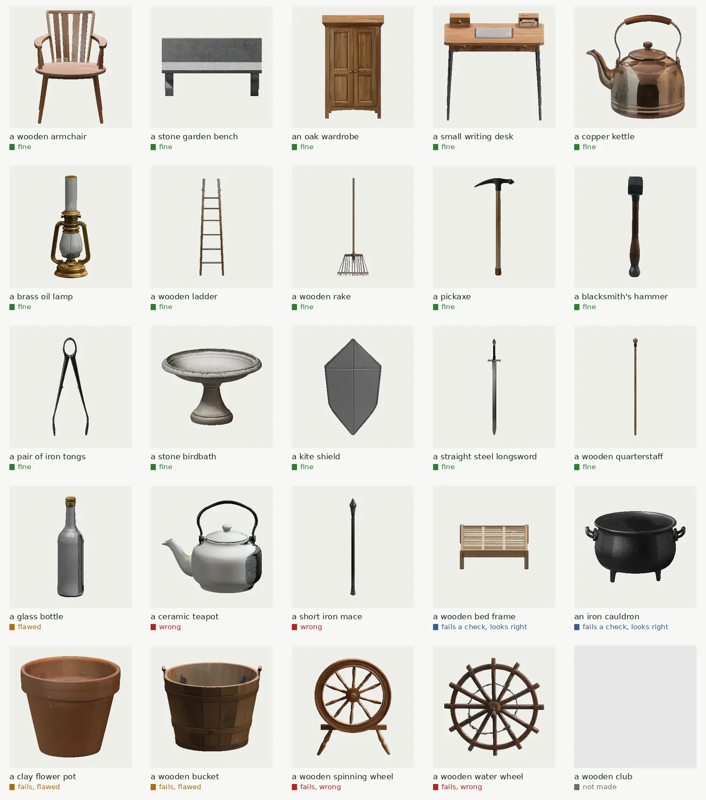

# Results, limits and what is not here yet

## 0.3.0 against 0.2.2

Fifty new prompts were written and sealed before this work began (`tools/trial/unseen-third.txt`). Each was made once
with 0.2.2 and once with this version's making code as it stood on 16 Nov, the same seeds, on a 12 GB RTX 3060 and on
a 16 GB RTX 3080 laptop card. Every object was judged by eye, blind, from all round and from below, by two judges. On
each card 48 prompts were made; 2 were made by neither version. The 0.3.0 columns are those objects judged by 0.3.0's checks (the fill check a note),
before the check "closed underneath" was added. The table gives the first judge's verdicts.

| Of 50 | 0.2.2, RTX 3060 | 0.3.0, RTX 3060 | 0.2.2, RTX 3080 | 0.3.0, RTX 3080 |
|---|---|---|---|---|
| pass every check and right | 19 | 27 | 20 | 27 |
| pass every check but wrong | 6 | 8 | 5 | 8 |
| right but refused by a check | 14 | 6 | 11 | 4 |
| wrong and refused | 9 | 7 | 12 | 9 |
| not made | 2 | 2 | 2 | 2 |

**More right objects pass, and more wrong ones pass too.** Right objects that pass went from 19 and 20 to 27 on each
card; wrong objects that pass went from 6 and 5 to 8; right objects refused went from 14 and 11 to 6 and 4. No object
that was right and passed with 0.2.2 was lost. What frees them is the fill check made a note: counted as before, the
same objects give 18 right on the 12 GB card and 16 on the 16 GB card, as the wider touch-up views fill more and the
check then refused more. An object that passes with a filled patch carries the note, and its report shows the patch.

We had set ourselves a bar before opening the list, for each card: right objects that pass rise by at least 3; wrong
objects that pass rise by at most half that rise; at most one object that 0.2.2 made right and passed is lost;
invented detail above or below does not rise; the regression set holds; and the 50 take at most 1.5 times 0.2.2's
time. It was counted with 21 verdicts that a third judge gave again. With them, right objects that pass are 25 on each
card (0.2.2: 19 on the 12 GB card, 18 on the 16 GB card) and wrong ones 10 on each (0.2.2: 6 and 7). On the 12 GB card
that is +6 right and +4 wrong, where half the rise allows 3: **the bar was missed there by one object.** On the 16 GB
card it is +7 right and +3 wrong, under the 3.5 allowed, only if one disputed object is counted as right; counted
wrong, it is +6 and +4, missed as on the other card. No object that 0.2.2 made right and passed was lost, and the
regression set holds. Invented detail and the time were never counted, so we say nothing of them. A stricter second
judge counted the rise in wrong objects that pass at +7 on the 12 GB card and +6 on the 16 GB card.

After that measurement we added the check "closed underneath" (`objects.md`, "Open underneath"). Counted again on the
same judged objects, it refuses one wrong object on each card, a wooden jewellery chest made open underneath, and
nothing right: wrong objects that pass are then 7 on each card by the first judge's verdicts, and 9 on each with the
third judge's 21 (against 0.2.2: +3 on the 12 GB card, +2 on the 16 GB card). Made again with the release, the chest
would not stop at that refusal: a shape that fails a check gets a second shape try, and the chest's second shape was
never made or judged. That check was chosen after the list was opened, so this is a recount, not a measurement, and we do not say the bar was reached. It misses a known case: a
bowl-like open side that reaches the outline (a stone pestle made as a mortar).

The stored objects of this list were checked again with the release's own checks on both cards: every status is the
one counted above with "closed underneath" added, 50 of 50 a card. The objects of both versions are kept with their
verdicts.

## 0.2.2 against 0.2.1

Fifty new prompts were written and sealed before this work began (`tools/trial/unseen-next.txt`). Each was made once
with 0.2.1 and once with this version's making code, frozen on 14 Nov, the same seeds, on a 12 GB RTX 3060 and on a 16
GB RTX 3080 laptop card, and every object was judged by eye, blind, from all round and from below. The 0.2.2 column is
the objects made by this version's making code (94 of 96 identical to 0.2.1's) judged by 0.2.2's checks: the question
judge counted (its question, limit and bar written down before the verdicts were opened), and the holes check that no
longer judges a hole too small for the picture's cut-out to keep.

Two fixes were made after the list was opened, on objects of this list: the holes check (found on its bread board,
the one more right object that passes on each card: without it, 15 and 13) and the reading of "a chess board" (no
number changes: the board is still refused; 0.2.2 would make it larger and lying flat, which was not measured).

| Of 50 | 0.2.1, RTX 3060 | 0.2.2, RTX 3060 | 0.2.1, RTX 3080 | 0.2.2, RTX 3080 |
|---|---|---|---|---|
| pass every check and right | 15 | 16 | 15 | 14 |
| pass every check but wrong | 16 | 9 | 14 | 9 |
| right but refused by a check | 9 | 8 | 8 | 9 |
| wrong and refused | 8 | 15 | 11 | 16 |
| not made | 2 | 2 | 2 | 2 |

**Fewer wrong objects get through; no more right ones are made.** The question judge looks at each finished object
from eight sides and is asked about the thing the words name ("Is it a crossbow bolt?"); below 50 % yes, the object
is refused. It stopped 7 wrong objects on the 12 GB card and 5 on the 16 GB card: a crossbow made for a crossbow
bolt, a plain disc for a round shield with a boss, a sabre for a falchion. On the 16 GB card it also refused 2 right
ones (a narrow coffee table, asked about as "a table", and a stone gargoyle). A wooden bread board, refused before
for a hole its picture could not show, now passes on both cards.

Most wrong objects that still pass are another thing drawn, or paint faults. Two prompts are not made at all, read as
something model-maker does not make yet: "a clothes horse" (an animal) and "a bow saw" (a bow); the next version reads
names better. The measured objects, both versions, are kept with their verdicts; 0.2.2's code is the code of this
release.

## 0.2.1 against 0.2.0

Fifty new prompts were written and sealed before this work began (`tools/trial/unseen-0.2.1.txt`); nothing was tuned
on them. Each was made once with 0.2.0 and once with 0.2.1, the same seeds, on a 12 GB RTX 3060 and on a 16 GB RTX 3080
laptop card. Every object was judged from renders all the way round **and from below**, by one judge (an AI model), blind: which version made which object, and the checks' verdicts, were hidden until all were judged. The
0.2.0 column ran at 0.2.0's own code (2c3ea6e).

| Of 50 | 0.2.0, RTX 3060 | 0.2.1, RTX 3060 | 0.2.0, RTX 3080 | 0.2.1, RTX 3080 |
|---|---|---|---|---|
| pass every check and right | 18 | 22 | 20 | 21 |
| pass every check but wrong | 13 | 11 | 10 | 9 |
| right but refused by a check | 11 | 10 | 11 | 13 |
| wrong and refused | 6 | 5 | 8 | 6 |
| not made | 2 | 2 | 1 | 1 |

**0.2.1 is a little better, not much.** On the 12 GB card four prompts gained (a hammer now stands upright, a mug and
a jug were repainted, a trough's fill passes); on the 16 GB card the hammer gained and a mug and a saucepan were
painted right but are now refused by a check. None got worse on either card; the rest came out the same, as the same
seeds paint the same pictures. Fifty prompts cannot tell a gain of a few from chance with confidence. We aimed at 35
and reached 21 to 22; that is why this is 0.2.1 and not 0.3.0.

One object in five (9 to 11 of 50) passes every check and is wrong: 6 to 8 times the picture model drew another thing (a
digging fork for a hoe, a pick on a pole for a scythe), and no check asks "is this the thing named?". Ten to thirteen
right objects are refused. Both are the next version's work.

These numbers are stricter than the 25-prompt table below: undersides were not judged there, so 22 of 50 and 15 of 25
are not the same measure. The whole run took 6.7 hours on the 16 GB card and 7.9 hours on the 12 GB card: 8 to 9.5
minutes an object. See the objects of earlier versions in 3-D in your browser:
**[Model Maker Studio](https://cicadapark.com/model-maker-studio/)** (cicadapark.com).

## 0.2.0's 25

This was the first measured release: the object path had been through a handful of trials on two cards (`objects.md`,
`trials/`).

**Pass rate: 15 of 25 right; 18 of 25 pass every check.** Twenty-five prompts were written before this version
was frozen and kept sealed: nothing was tuned on them (`tools/trial/unseen-0.2.0.txt`). Each was made once, at the
frozen code, on each of two cards: a 16 GB RTX 3080 laptop card and a 12 GB RTX 3060. On the 3080, 18 passed every
check (19 on the 3060). Every object was then looked at by eye, turned all the way round: on each card 15 of 25 pass
every check and are right. Both cards paint the same pictures from the same seeds, so their objects are near alike.
The whole run took 4.0 hours on the 3080 and 3.5 hours on the 3060: 8 to 10 minutes an object. See them in 3-D,
turned round in your browser: **[Model Maker Studio](https://cicadapark.com/model-maker-studio/)** (cicadapark.com).

| Prompt | Checks (3080) | By eye |
|---|---|---|
| a wooden armchair | pass | fine |
| a stone garden bench | pass | fine |
| an oak wardrobe | pass | fine |
| a small writing desk | pass | fine |
| a copper kettle | pass | fine |
| a brass oil lamp | pass | fine; its glass chimney painted opaque |
| a wooden ladder | pass | fine |
| a wooden rake | pass | fine |
| a pickaxe | pass | fine |
| a blacksmith's hammer | pass | fine |
| a pair of iron tongs | pass | fine: one object, as it should be |
| a stone birdbath | pass | fine |
| a kite shield | pass | fine |
| a straight steel longsword | pass | fine |
| a wooden quarterstaff | pass | fine |
| a glass bottle | pass | the glass painted dark on one side |
| a ceramic teapot | pass | wrong: large black patches painted on one side |
| a short iron mace | pass | wrong: a long thin rod with a small knob |
| a wooden bed frame | fail (outline, holes) | looks right |
| an iron cauldron | fail (paint fill) | looks right |
| a clay flower pot | fail (paint) | grey smears inside |
| a wooden bucket | fail (paint fill) | a tub with side handles; dark smears inside |
| a wooden spinning wheel | fail (paint fill) | wrong: a wheel on a stand |
| a wooden water wheel | fail (paint) | wrong: a wheel with no paddles |
| a wooden club | not made | no picture try showed a club |

Twenty-five prompts are still a small sample: the true rate of right objects could plausibly be anywhere from about
4 in 10 to 3 in 4. These 25 are now part of the development set. The first version's ten (`unseen-final.txt`) gave
4 of 10 passing every check, 2 of them right by eye.

### The first version's ten

**Pass rate: 4 of 10.** Ten prompts kept aside during development (`tools/trial/unseen-final.txt`) were made once,
at the release's code, on a 16 GB card (an RTX 3080 laptop card), about 7.5 minutes an object (the median). Four
passed every check. "Passes every check" is not "is right": each object looked at by eye says more.

| Prompt | Checks | By eye |
|---|---|---|
| a copper cooking pot with a lid | pass | fine |
| a wooden mallet | pass | fine |
| an iron anvil | pass | nonsense lettering painted on its side |
| a short curved dagger | pass | straight, though "curved" was asked |
| a wooden rocking horse | fail (paint fill) | looks right |
| a pair of leather boots | fail (paint fill) | one boot for "a pair" |
| a stone well with a wooden roof | fail (symmetry) | a smooth grey inner wall |
| a tall wooden bookshelf, empty | fail | its back and sides are bare |
| a wooden wheelbarrow | fail (outline, holes) | |
| a woven wicker basket | fail | a flat tray on its rim, not a basket |

Ten prompts are a small sample: the true rate could plausibly be anywhere from about 1 in 8 to 3 in 4. These ten
were made once for this number and are now part of the development set.

## Not yet

* bows (a bow prompt is answered that they come later; nothing is made);
* animals (a later release; they are next in the work);
* things that open and shut (a chest's lid, a door, a book's cover): made shut, in one piece, for now;
* characters, meaning people and fantasy creatures (after the animals); a statue of either is an object, and a prompt
  that names both ("a knight on a horse") is answered as a character;
* Windows and macOS; WSL2 on Windows should work the same but has not been tried;
* making an object without an NVIDIA card: there is no CPU path for the picture, shape and paint models (the checks,
  the bake and the report do run on the CPU: `./model-maker inspect`, `./model-maker finish`).

## Known limits

* one object at a time: two of one thing ("a pair of boots", "two candlesticks") is made once and placed twice, the
  second its mirror image or its copy (`objects.md`, "Pairs"); three or more, a set, or two different things are
  answered before any painting, asking for one thing ("a pair of scissors" and "a pair of tongs" are one object, and
  made);
* of the qualities a prompt names, "curved" and "round" are judged; others ("tall", "broken", "rusty") are not;
* lettering painted on an object is caught when it is written straight across a flat face; lettering round a rim (a
  coin, a medal) and very small marks still get through;
* a side painted out of family with the other views (the teapot's black patches) is painted again; two neighbouring
  views wrong together, and polished metal, are not caught;
* a near relative can pass for the thing asked for (a rod with a knob for a mace);
* the fill check is a note since 0.3.0, so an object whose touch-up painted a patch out of keeping with the paint
  round it (a grey patch, a smear) passes: the note and the patch are in its report, so look at it before you use the
  object;
* "closed underneath" misses a bowl-like open side that reaches the outline (a pestle made as a mortar), and runs only
  for things that stand on their own base; it would refuse a right thing whose base is closed all round with its
  underside more than 15 % of its height up (a chair or stool with low stretchers on all four sides, a chest on a deep
  skirt, a platform bed): none of 309 stored objects was one, and `--stands no` leaves the check out;
* the outline is measured against its own size, so a long, low thing with a paint fault the outline once caught by
  chance (a rolling pin with lettering stamped on it) passes.
