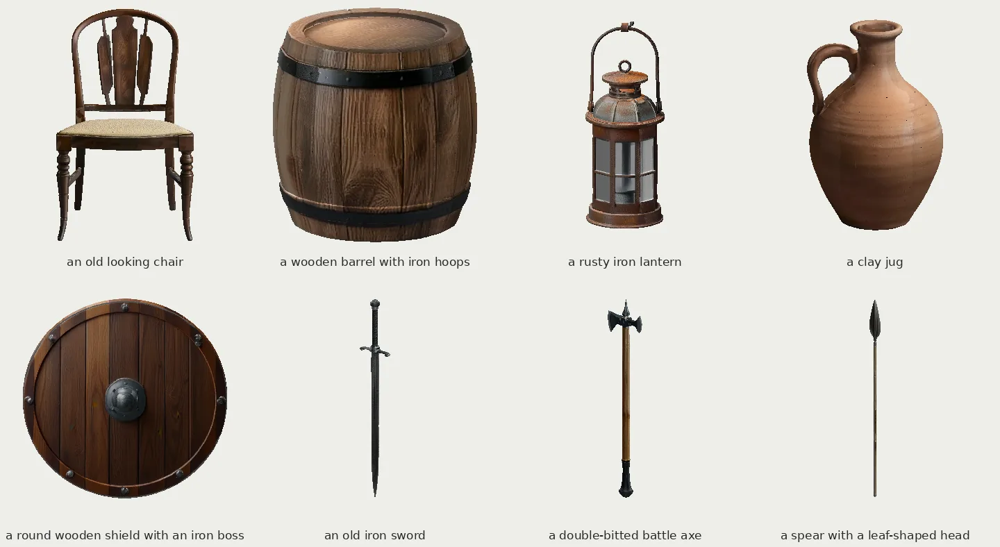
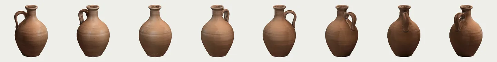
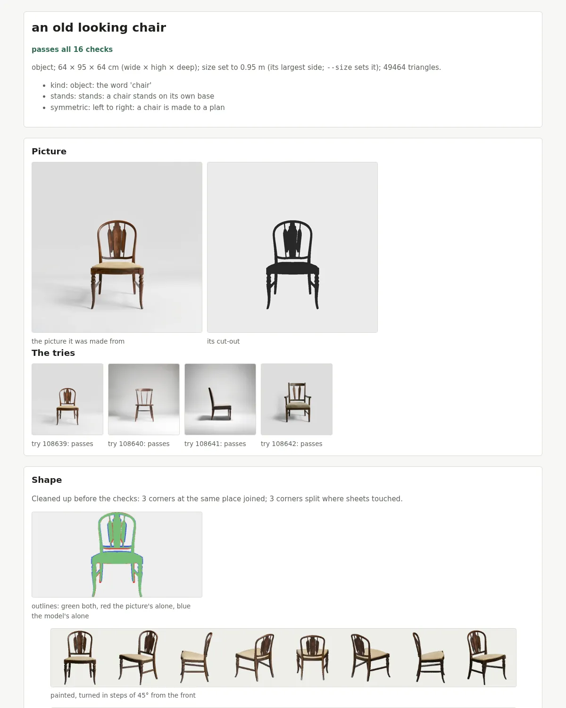

# What you get

model-maker makes **3-D objects**: furniture, containers, tools, decor, and things held in the hand such as
swords, axes, spears and shields. Animals come in a later release, and characters (people and fantasy creatures)
after the animals.

Every object is checked, and each check is measured: its outline against its picture, the mesh
whole (no holes, no loose pieces), standing on its base, mirror-symmetric where the words imply it,
the paint covering it, and what the paint touch-up filled in matching the paint round it. For a thing held in the hand,
its blade or shaft is checked straight, its grip found and its length set, and its `.glb` marks the grip and the tip
so a game can put it in a hand. Each object
comes with a report of every check and a sidecar naming every model used and its licence. Every picture it writes
carries content credentials (C2PA), a signed mark saying it was made by AI models; please do not strip them
([licences and content credentials](licences.md)). See [`objects.md`](objects.md).

## What it makes

See them in 3-D, turned round in your browser: **[Model Maker Studio](https://cicadapark.com/model-maker-studio/)** (cicadapark.com).

Eight objects made during this release's development, each from the line of text under it, each passing every
check. Every one is a `.glb` you can open in any 3-D tool, turned all the way round:

And every one comes with a report of its checks: the picture it was made from, its cut-out, the tries, the outline
against the picture, the paint, and each check's value against its limit.

## For each object

For each object, in its own folder, `made/<name>-<id>/` (`--out DIR` chooses another folder): its `.glb` (open it in
any 3-D tool or game engine), its sidecar (`<name>.provenance.json`: the prompt, every model used with its version and
licence, the seeds, every check) and its report (`report/report.html`: every check, measured, with the pictures it was
judged by).

## What is here

| Folder | What it holds |
|---|---|
| `model-maker` | the command: `make`, `batch` (run again with the same `--out`, it goes on where it stopped), `finish`, `inspect`, `picture-check`, `words`, `bug-report`, `reproduce`, `credentials` |
| `python/` | the pipeline: pictures, cut-out, shape, paint, the checks, the bake, the `.glb`, the report (`python/tests/` its tests) |
| `crates/` | the Rust crate `model-maker-simplify` (a shape to its triangle budget) |
| `registry/` | the AI models the pipeline uses, their licences and the sha256 of their files |
| `setup.sh`, `setup/` | the one command that sets a PC up ([`setup.md`](setup.md)) |
| `docs/` | how the pipeline works ([the index](README.md)) |
| `tools/` | the repository's own checks, and `tools/trial/` (the release's trial prompts and how to run them) |
